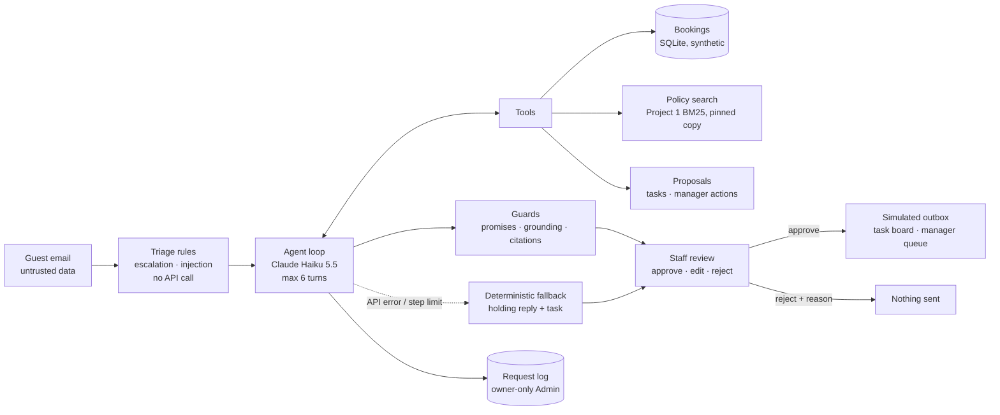
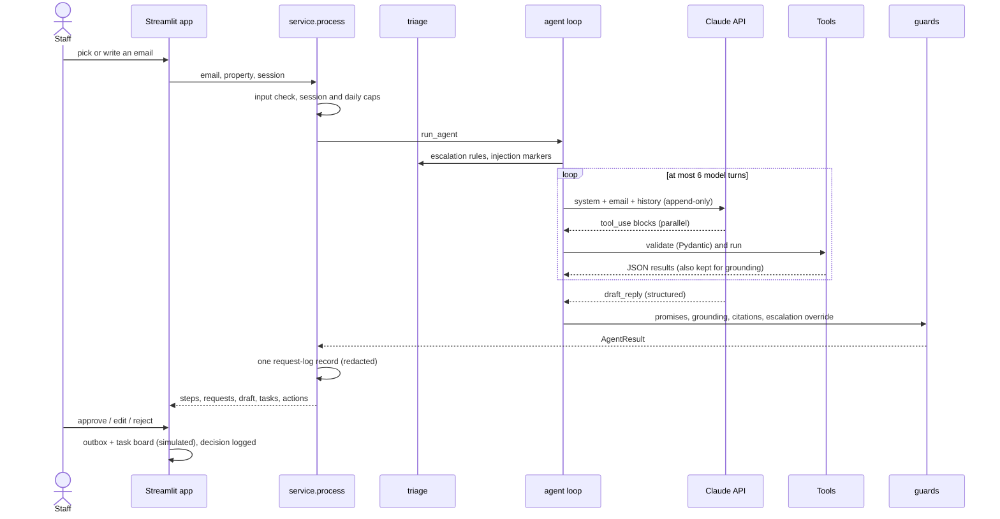

# Architecture

Guest Request Agent turns a guest email into a reviewed reply. A simulated client engagement for a fictional hotel
group (Beach Resort, Mountain Lodge, brand-wide documents), with synthetic data. Nothing is ever sent.

## System diagram

## Request flow

1. **Input check** (`src/service.py`, `src/triage.py`): text typed into "Write your own email" that is empty, too
   long, a greeting or off-topic gets a friendly reply without an API call. Session cap (10) and daily cap (150).
2. **Triage** (`src/triage.py`): escalation rules (injury, medical, safety, legal, harassment, discrimination,
   press, refund demand in a complaint, very angry tone) and prompt-injection markers. Both are steps in the timeline.
3. **Agent loop** (`src/agent.py`): a manual Claude tool-use loop. Each model turn may call several tools in
   parallel; all results go back in one message. The model's turn (thinking blocks included) is appended unchanged.
   The loop ends when the model calls `draft_reply` (validated with Pydantic; an invalid one is sent back once).
4. **Tools** (`src/tools.py`): `find_booking` (sender's own bookings only), `check_availability`, `search_policy`
   (Project 1's retrieval), `propose_task`, `propose_action` (always "needs manager approval"), and `draft_reply`.
5. **Guards** (`src/guards.py`): forbidden promises replaced; dates, prices, times, room numbers and quantities
   checked against tool results; unknown citations removed; when the rules escalated but the model didn't, the
   draft becomes a holding reply.
6. **Fallback**: API error after one retry, a model refusal, no final answer or the step limit → a polite holding
   reply and a front-desk task. The email is never dropped.
7. **Approval** (`src/approval.py`): only Approve puts the reply (citation markers removed) into the session outbox
   and opens the tasks; actions go to the manager queue, still unapproved. Reject needs a reason.
8. **Log** (`src/usage.py`, `src/requestlog.py`): one redacted record per email and one per decision; the Admin page
   lists them with a details dialog (summary, email, agent steps, draft vs final diff, tasks and actions,
   performance, checks, raw JSON).

## Components

| Component | File | Responsibility | Tested in |
|---|---|---|---|
| Settings | `src/config.py` | Environment variables, prices and caps as config | every test |
| Synthetic data | `scripts/make_data.py`, `src/bookings.py` | Seeded bookings DB, built on first start; read-only queries | `tests/test_data.py` |
| Policy search | `src/policy/` (copied), `src/policy_search.py`, `scripts/sync_policy.py` | Project 1 BM25 at commit 1e7ae1e, index built on first use | `tests/test_data.py`, `tests/test_tools.py` |
| Triage | `src/triage.py` | Escalation, injection, greeting, off-topic, language | `tests/test_triage.py` |
| Tools | `src/tools.py`, `src/models.py` | Typed tool inputs, JSON results, step summaries | `tests/test_tools.py` |
| Agent | `src/agent.py` | Loop, step cap, retry, fallback, structured output | `tests/test_agent.py` |
| Guards | `src/guards.py` | Promises, grounding, citations | `tests/test_guards.py` |
| Service | `src/service.py` | Caps, logging, reused results | `tests/test_service.py` |
| Approval | `src/approval.py` | Outbox, task board, manager queue | `tests/test_approval.py` |
| Request log | `src/requestlog.py`, `src/usage.py` | Records, redaction, list and details views | `tests/test_requestlog.py` |
| Admin | `src/admin.py`, `views/admin.py` | Project 1's gate, health, usage, request log | `tests/test_admin.py`, `tests/test_pages.py` |
| Evals | `eval/metrics.py`, `eval/run_eval.py` | Deterministic metrics, live runs, replay for CI | `tests/test_metrics.py` |

## Scaling path
- **Real PMS and email:** replace `BookingStore` with a read-only PMS client and the inbox with a mail connector
  (IMAP/Graph). Sending stays behind approval; the outbox becomes a real send through the hotel's mail system.
- **Persistent audit:** the request log moves from JSONL on temporary disk to a database with retention (Project 4).
- **Throughput:** emails are independent; a queue and worker pool parallelize them. At the measured ~2.3 tool steps
  per email the cost is dominated by input tokens; prompt caching of the stable system prompt and tool definitions
  is the next saving.
- **Evaluation at scale:** Project 3 grows the 40 labelled cases into a harness with LLM-as-judge calibrated
  against human labels for tone and helpfulness, which the deterministic metrics here don't measure.
